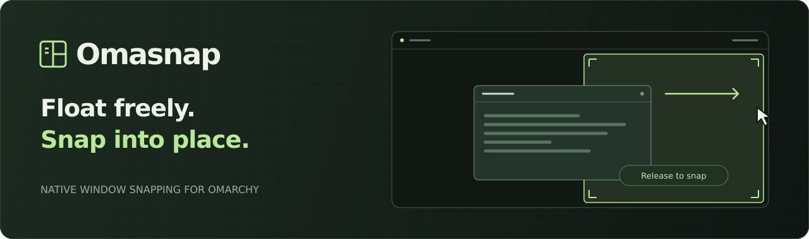
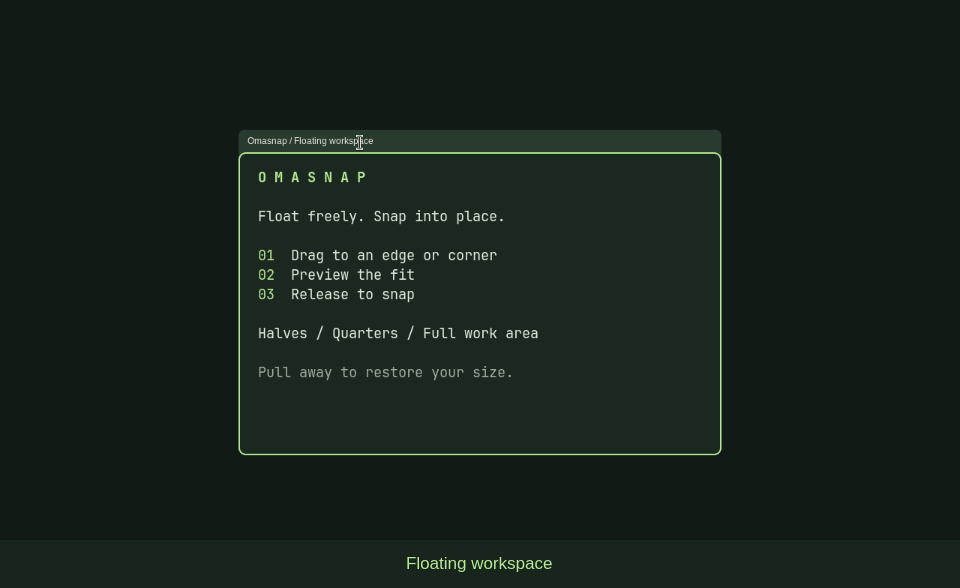

<p align="center">
  
</p>

<p align="center">
  <a href="https://omarchy.org"></a>
  <a href="https://hypr.land"></a>
  <a href="LICENSE"></a>
</p>

<p align="center">
  Window snapping for Omarchy's native floating workspaces.<br />
  Halves, quarters, and a full work area — one drag away.
</p>

<p align="center">
  <a href="#install">Install</a> ·
  <a href="#use">Use</a> ·
  <a href="#configure">Configure</a> ·
  <a href="#development">Development</a>
</p>

## See it in action



- **See before you snap.** Live previews follow your Omarchy accent color.
- **Get your size back.** Pull a snapped window away to restore its previous size.
- **Keep windows within reach.** Free drops leave a titlebar grip on screen.
- **Fit your desktop.** Placement respects panel reservations and your chosen gap.

Active only in **native floating workspaces**. Uses your existing drag bindings and titlebars.

## Install

```sh
omarchy plugin add https://github.com/hudrucan/omasnap --enable
```

**Tested on Omarchy 4.5 rc3 · Hyprland 0.56.2.** Requires Python 3, `pkg-config`,
`g++` with C++26 support, and matching Hyprland development headers
(`pkg-config hyprland` must succeed). The native module builds on first use.

After updating Hyprland, log in again before enabling Omasnap so the running
compositor matches the installed headers.

## Use

Drag a window by its **titlebar**, or hold **Super + left-drag** anywhere on it.
Move to an edge or corner, then release when the preview appears.

| Drop at | Snap to |
| :--- | :--- |
| Left or right edge | Half of the work area |
| Any corner | Quarter of the work area |
| Top center | Full work area |
| Bottom center | Bottom half |

**Change your mind?** Move away from the edge or press **Esc** to cancel snapping.
Drag a snapped window away to restore its previous size.

Using Omastation from macOS? Its **Option/Alt + drag** alias works the same way.

## Configure

Defaults work out of the box. Settings apply live.

<details>
<summary><strong>Snap zones, gaps, and preview</strong></summary>

Merge these fields into the existing `omasnap.window-snap` entry in the `plugins`
array of `~/.config/omarchy/shell.json`. Keep its other fields.

```json
{
  "id": "omasnap.window-snap",
  "edge": 24,
  "corner": 160,
  "gap": 8,
  "preview": true,
  "keepVisible": true
}
```

| Setting | Default | Controls |
| :--- | :--- | :--- |
| `edge` | `24` | Activation strip width |
| `corner` | `160` | Corner span along each edge |
| `gap` | `8` | Inset from the snap area's boundaries |
| `preview` | `true` | Show the destination while dragging |
| `keepVisible` | `true` | Keep a titlebar grip on screen after free drops |

Distances use logical pixels. Preview color follows your Omarchy theme.

</details>

<details>
<summary><strong>Update, disable, or remove</strong></summary>

```sh
omarchy plugin update omasnap.window-snap
omarchy plugin disable omasnap.window-snap
omarchy plugin enable omasnap.window-snap
omarchy plugin remove omasnap.window-snap --yes
```

</details>

<details>
<summary><strong>Control from the terminal</strong></summary>

```sh
hyprctl omasnap status
hyprctl omasnap snap left
hyprctl omasnap restore
```

Snap targets: `left`, `right`, `top`, `bottom`, `top-left`, `top-right`,
`bottom-left`, `bottom-right`.

</details>

## Development

```sh
git clone https://github.com/hudrucan/omasnap.git
cd omasnap
./validate
```

Checks geometry, the manifest, QML and Python syntax, then builds the native
module. [Integration tests](tests/README.md) cover live dragging in a separate
Hyprland instance. To install a clean, committed checkout locally, run `./install-local`.

`Service.qml` manages the native module's lifecycle; disabling the plugin unloads it.
Builds are cached in `~/.cache/omasnap-window-snap/` (or under `$XDG_CACHE_HOME`)
and checked against the running Hyprland ABI.

Found a bug? [Open an issue](https://github.com/hudrucan/omasnap/issues) with your
Omarchy and Hyprland versions, drag method, and steps to reproduce.

---

<p align="center">Made for <a href="https://omarchy.org">Omarchy</a> · <a href="LICENSE">MIT licensed</a></p>
